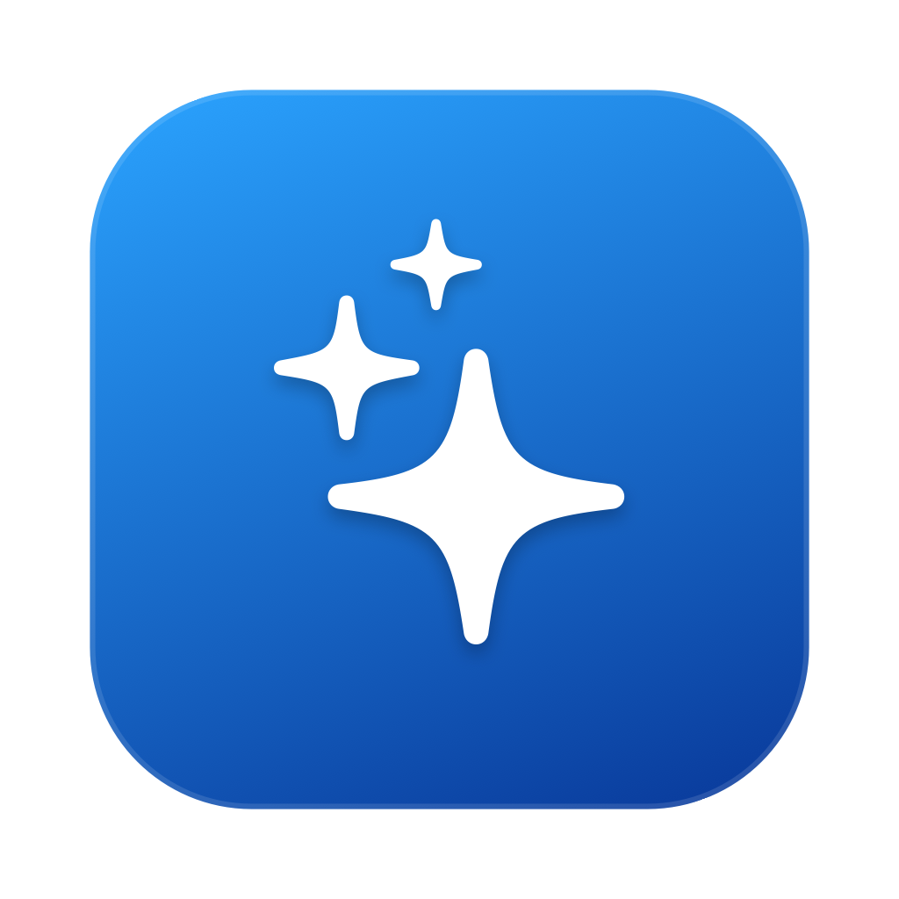
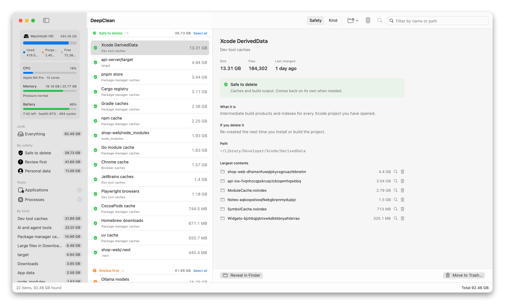

<p align="center">
  
</p>

# DeepClean

A small native macOS app that finds the junk eating your disk, explains what every item is,
and moves it to the Trash only after you confirm.

- Swift + SwiftUI, no third-party dependencies, under 3 MB
- Read-only scan. Deleting is always a separate, explicit step and goes to the Trash (recoverable)
- Built for developers: package manager caches, `node_modules`, build output, simulators, AI tool caches, leftover app data
- Also shows storage, CPU, memory, battery, running processes, and installed apps with their leftovers
- Apple silicon, macOS 14 Sonoma or newer

<picture>
  <source media="(prefers-color-scheme: dark)" srcset="docs/screenshot-dark.png">
  
</picture>

## Install

1. Download `DeepClean-<version>.zip` from the [latest release](https://github.com/bunthondev/deep-clean/releases/latest).
2. Double-click the zip to unpack it, then drag `DeepClean.app` into `/Applications`.
3. The app is not notarized by Apple (it is a free, unsigned build), so the first launch is blocked by Gatekeeper. Either:

   **Terminal (one line):**
   ```sh
   xattr -d com.apple.quarantine /Applications/DeepClean.app
   ```
   then open it normally.

   **Or without Terminal:** open the app once (macOS says it cannot be opened), then go to
   System Settings > Privacy & Security, scroll down, and click **Open Anyway** next to DeepClean.

4. When the app asks for **Full Disk Access**, grant it in System Settings > Privacy & Security > Full Disk Access
   and relaunch. Without it, Mail, Safari and Messages caches are skipped; everything else still works.

To uninstall, quit DeepClean and move `/Applications/DeepClean.app` to the Trash. It stores only a small
preferences file at `~/Library/Preferences/com.devkh.deepclean.plist`.

### Updating

There is no auto-update yet. Download the new zip from the releases page and replace the app in
`/Applications`. Repeat the quarantine step above after each update.

## What it scans

1. **Known cache locations** (`Catalog.swift`): package manager caches (npm, pnpm, Yarn, Bun, pip, uv, Cargo, Go, Gradle, CocoaPods, Homebrew…),
   dev tool caches (Puppeteer, Playwright, Prisma, Xcode DerivedData, iOS simulators, Android SDK…), AI agent tools
   (Claude Code, Codex, Cursor, Ollama models, Hugging Face…), editors, browsers, app data and system folders.
   Each entry carries a plain-language description, what happens after deleting it, and a safety tier.
2. **Generated folders inside projects**: walks your project roots (default `~/dev`, `~/Projects`,
   `~/Code`… whichever exist, add more via the toolbar) and lists `node_modules`, `target`, `.next`,
   `dist`, `build`, `.venv`, `Pods` and similar. Folders like `dist`/`build`/`target` only count when a
   matching manifest (`package.json`, `Cargo.toml`, `pom.xml`…) sits next to them.
3. **Downloads and Desktop**: single files over 200 MB, installers/archives in Downloads, and
   Downloads untouched for 180 days.

## Safety tiers

| Tier | Meaning | Trash button |
|---|---|---|
| Safe to delete | Regenerates itself when needed | enabled |
| Review first | Junk only if you stopped using the tool/project | enabled |
| Personal data | Your files, listed for awareness | disabled |

Select several rows with ⌘-click or shift-click (or "Select all" in a section header), then use
**Trash selected** in the toolbar or the right-click menu. One confirmation covers the whole batch;
personal items in the selection are skipped.

## Grouping and drill-down

The toolbar picker switches the list between **Safety** (tiers) and **Kind**. In Kind mode every
project artifact is its own section named after the folder (`node_modules`, `target`, `.next`,
`venv`…) and catalog items keep their category (`Browser caches`, `Package manager caches`…).
Each section header shows the count, total size and a "Select all" link, so trashing every
`node_modules` on the machine is: Kind > Select all > Trash selected > confirm.

The detail pane lists the ten largest items directly inside the selected folder, each with a
reveal button and, for non-personal tiers, a trash button. Useful for things like Postgres data
or a package cache where only one subfolder is worth removing.

Project folders added via the toolbar are remembered between launches. Remove one from the same menu.

## Storage and system

The sidebar starts with a storage card for the boot volume: used, purgeable (space macOS holds in
snapshots and caches and frees on demand) and free. It refreshes after every scan and every trash.

Below it a system card refreshes every two seconds: CPU load across all cores with the chip name,
memory used (app + wired + compressed, like Activity Monitor) with the kernel's memory-pressure
level, and on laptops the battery level, charging state, time to empty or full, health (max vs
design capacity), cycle count and temperature. Readings come from Mach host statistics, sysctl and
IOKit, so no helper process or elevated rights are needed.

## Tools > Applications

Lists every app in `/Applications` and `~/Applications` with its size, source (App Store receipt,
Homebrew Caskroom, or downloaded), version, and last-used date from Spotlight. Selecting an app
finds its leftovers in `~/Library` (Application Support, Caches, Preferences, Containers, Group
Containers, HTTPStorages, WebKit, Logs, Saved state, Launch agents, Cookies, Application Scripts)
matched by bundle identifier and exact app name. Uncheck anything to keep, then **Uninstall**
moves the app and the checked leftovers to the Trash after one confirmation, or **Remove leftovers
only** keeps the app. Running apps cannot be uninstalled until quit.

Apps installed by a root-owned installer (Microsoft Office, Adobe, many `.pkg` installs) cannot be
moved by the app directly, so it asks Finder to do it. Finder shows the usual password prompt and
still moves the item to the Trash. The first time, macOS asks whether DeepClean may control Finder;
that choice lives in System Settings > Privacy & Security > Automation.

## Tools > Processes

Lists every running process grouped by app (an app bundle and all its helpers count as one row, so
Chrome shows one line, not thirty) with CPU and memory, sorted by either. Selecting a group shows
each process with its PID, user, CPU and memory, the group's share of used memory, and **Quit**
(normal, like ⌘Q) or **Force Quit** (kills immediately, after confirmation). Own processes are read
through libproc: memory is the physical footprint that Activity Monitor shows, CPU is the change in
CPU time between samples. Root-owned processes come from one `ps` call per sample. Sampling runs
every 3 s only while the view is open.

## Command line

The same binary has text-only modes, handy for scripts or quick checks:

```sh
/Applications/DeepClean.app/Contents/MacOS/DeepClean --cli      # junk scan
/Applications/DeepClean.app/Contents/MacOS/DeepClean --apps     # storage + 15 largest apps with leftovers
/Applications/DeepClean.app/Contents/MacOS/DeepClean --procs    # 15 biggest process groups
/Applications/DeepClean.app/Contents/MacOS/DeepClean --system   # one CPU / memory / battery reading
```

## Build from source

Only the Command Line Tools are needed (`xcode-select --install`), not Xcode.

```sh
git clone https://github.com/bunthondev/deep-clean.git
cd deep-clean
./build.sh          # builds DeepClean.app in this folder
./build.sh --run    # build and open it
./release.sh        # build + dist/DeepClean-<version>.zip for a GitHub release
```

### Signing

`build.sh` ad-hoc signs the app, and an ad-hoc signature changes on every build, so macOS forgets
the Full Disk Access grant between rebuilds. Any stable certificate fixes that:

1. Keychain Access > Certificate Assistant > Create a Certificate…
   Name `DeepClean Dev`, Identity Type `Self Signed Root`, Certificate Type `Code Signing`.
2. `SIGN_IDENTITY="DeepClean Dev" ./build.sh`

A paid Developer ID certificate works the same way and is needed only to notarize builds for other Macs.

### Layout

```
Sources/DeepClean/
  DeepCleanApp.swift   app entry + --cli / --apps / --procs / --system modes
  Models.swift         Tier, CleanItem, formatters
  Catalog.swift        known junk paths and project artifact rules
  DiskSize.swift       fast allocated-size walker
  Scanner.swift        the three scan passes, streamed as AsyncStream
  Apps.swift           StorageInfo, InstalledApp, AppScanner (app list + leftovers)
  SystemStats.swift    CPU / memory / battery sampler (Mach, sysctl, IOKit)
  Processes.swift      per-process sampler (libproc + ps), grouping by app, quit / force quit
  ScanViewModel.swift  UI state, trash + reveal actions
  DebugHooks.swift     synthetic clicks + window snapshots for headless UI checks
  DemoData.swift       sample items for screenshots (DEEPCLEAN_DEBUG=demo)
  Views/               ContentView (sidebar, list, banner), DetailView, MultiDetailView,
                       AppViews (storage card, app list, app detail), SystemCard, ProcessViews
Resources/Info.plist
Resources/make-icon.sh    regenerates AppIcon.icns (AppKit + sips + iconutil, no Xcode)
build.sh               swift build + wrap into DeepClean.app
release.sh             build.sh + zip into dist/
```

### Debugging without screen recording

```sh
DEEPCLEAN_DEBUG=junk DEEPCLEAN_SNAPSHOT=/tmp/out.png ./DeepClean.app/Contents/MacOS/DeepClean
```

Runs a scan, selects the first row and writes a rendering of the window from inside the app, so no
Screen Recording permission is needed. `demo` does the same with fixed sample data (`DemoData.swift`)
and is how the README screenshots are made; add `DEEPCLEAN_APPEARANCE=light` for the light one, then
`swift docs/frame-screenshot.swift in.png out.png` adds the rounded corners and shadow. `procs-click` sends a synthetic click to a row through the
window (a real AppKit event, no Accessibility permission needed). Other modes: `procs`,
`procs-noselect`, `apps`. See `DebugHooks.swift`.

### Notes for contributors

- Sizes are allocated size on disk, matching Finder's "on disk" figure.
- Keep every detail pane inside a `ScrollView`. A wrapping `Text` placed directly in the split
  view's detail column sent SwiftUI into a layout loop that blanked the sidebar on selection.
- `@State` is a macro in recent SDKs and its plugin ships only with full Xcode, so the view model
  uses `ObservableObject`/`@StateObject`. Keep it that way if you build with Command Line Tools.
- Bump `CFBundleShortVersionString` and `CFBundleVersion` in `Resources/Info.plist` before each release.

## License

MIT. See [LICENSE](LICENSE).
